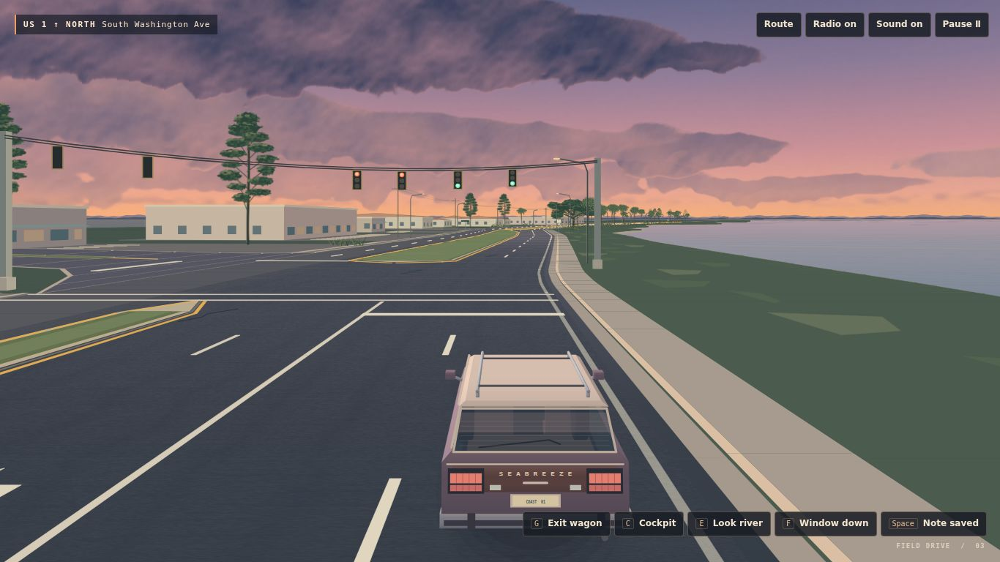

# Northbound Afterglow

**Contest submission project for OpenGame Game Jam #1 (2026)** · `global-ai-game-jam-2026`

Start beside your station wagon at Kennedy Point Park in Titusville, Florida. Drive north on US 1 as a rocket climbs across the Indian River. Watch the light, then listen: the roar reaches you from where the rocket *was*, not where you see it now.



**Status:** Playable work in progress (Field Drive 03). This is the public source repository for the contest project; the official OpenGame entry has not yet been submitted.

## Play locally

No account, API keys, package install, or asset downloads are needed to play from a clone. From the repository root:

```sh
python3 -m http.server 8000 --bind 127.0.0.1 --directory play
```

Open **http://127.0.0.1:8000/** and choose **Visit Kennedy Point**. Headphones make the delayed, directional launch sound easier to hear. If you already use the OpenGame CLI, `opengame dev . --port 8000` is an alternative local server.

| Control | Action |
| --- | --- |
| G | Enter at the driver's door, or exit once stopped |
| W / ↑, S / ↓ | Accelerate and brake; walk forward or back on foot |
| A / D or ← / → | Steer or walk sideways |
| C / E | Switch chase/cockpit view or look toward the launch |
| F / R | Open the passenger window or toggle the radio |
| Space | Save a listening note in this browser |
| B / P | Show the route or pause the visit |

## What's mapped and what's imagined

The 1.48 km drive follows the northbound carriageway of South Washington Avenue from Kennedy Point Park to Rotary Riverfront Park. The six named side roads follow Census geometry; turn lanes, medians and frontage are interpreted from a 2023 USDA aerial photograph. The car, walker, sky paintings and synthesized audio were made for this game. Building facades, park access and the distant launch are illustrated rather than surveyed; this is not a navigation tool or a reconstruction of a particular mission.

Map sources, reuse statements and the offline route builder are in [notes/maps](notes/maps/README.md). The [road-art reference](authoring/roadsurvey/README.md) documents the USDA imagery. `play/` contains the full browser game, including local art. It uses JavaScript modules, Canvas 2D and Web Audio.

## Check the build

With a recent Node.js and Python 3, run the route, interaction and sound tests from the repository root:

```sh
node --test tests/route.mjs && node tests/visit.mjs && node tests/sim.mjs
```

Optional Playwright keyboard and touch playthroughs are in `tests/mapped-journey.cjs` and `tests/mapped-touch.cjs`. With `playwright-core` and its Chromium browser installed, set `PREVIEW_URL=http://127.0.0.1:8000` to test a running local copy. Captures are written to `evidence/` (not tracked).
